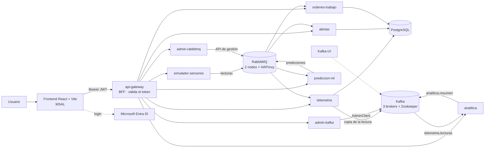

# EMaintenance · Mantenimiento predictivo

Plataforma de microservicios para monitorear equipos (camiones) en tiempo real, detectar anomalías con un modelo de machine learning y gestionar alertas y órdenes de trabajo. Los servicios se comunican de forma asíncrona con **RabbitMQ** (comandos y tareas) y **Apache Kafka** (flujo de telemetría para analítica en streaming). La autenticación y la autorización se hacen con **Microsoft Entra ID** (JWT) y todo el backend corre en contenedores con **Docker Compose**.

## Qué hace

1. El simulador publica lecturas de **temperatura, vibración y presión** de cada equipo en RabbitMQ. Al inyectar una falla, los tres sensores se degradan de forma correlacionada: suben la temperatura y la vibración, y cae la presión.
2. `telemetria` valida y guarda las lecturas en PostgreSQL y publica una **copia de cada lectura guardada en Kafka** (`telemetria.lecturas`).
3. `analitica` consume ese tópico de Kafka, calcula estadísticas por equipo y sensor sobre una ventana móvil de 5 minutos y las publica en `analitica.resumen`. Los mensajes inválidos van a una dead-letter topic (DLT).
4. `prediccion-ml` puntúa las lecturas con un modelo de detección de anomalías (Isolation Forest).
5. `alertas` genera alertas a partir de **umbrales por tipo de sensor** (configurables en `application.yml`) y de las predicciones del modelo.
6. Cuando el administrador reconoce una alerta, se crea la **orden de trabajo**, que después se asigna a un técnico y avanza por su ciclo de vida en `ordenes-trabajo`.
7. `admin-rabbitmq` administra colas, exchanges y bindings y reprocesa los mensajes de las DLQ. `admin-kafka` crea, modifica y elimina tópicos y sus configuraciones.
8. El frontend (React + Vite) inicia sesión con Microsoft y muestra pantallas distintas según el rol del usuario.

## Arquitectura



Hacia afuera, el backend solo publica el **gateway** (8080). Los puertos de infraestructura quedan atados a `127.0.0.1` (solo tu máquina): balanceador de RabbitMQ (5672 y 15672), brokers de Kafka (9092 a 9094) y Kafka-UI (8090). PostgreSQL solo se abre con el override de desarrollo. Los servicios de la aplicación quedan dentro de la red de Docker.

## Servicios

| Servicio | Puerto | Tecnología | Rutas principales |
|---|---|---|---|
| `api-gateway` | 8080 | Spring Cloud Gateway (WebFlux) | Punto de entrada único |
| `admin-rabbitmq` | 8081 | Spring Boot | `/api/queues`, `/api/exchanges`, `/api/bindings`, `/api/dlq` |
| `telemetria` | 8082 | Spring Boot + PostgreSQL + RabbitMQ + Kafka (productor) | `/api/lecturas` |
| `alertas` | 8083 | Spring Boot + PostgreSQL | `/api/alertas` |
| `ordenes-trabajo` | 8084 | Spring Boot + PostgreSQL | `/api/ordenes` |
| `simulador-sensores` | 8085 | Spring Boot | `/api/simulador` |
| `prediccion-ml` | 8086 | FastAPI (Python) | `/api/predicciones/estado`, `/health` |
| `admin-kafka` | 8087 | Spring Boot + Kafka AdminClient | `/api/kafka/cluster`, `/api/kafka/topics` |
| `analitica` | 8088 | Spring Boot + Kafka (consumidor y productor) | `/api/analitica/resumen`, `/api/analitica/estado` |
| `mantenimiento-web` | 5173 | React + Vite + MSAL | — |
| `ml` | — | Scripts de entrenamiento (scikit-learn) | No se despliega |

Infraestructura:

| Componente | Puerto (solo `127.0.0.1`) | Descripción |
|---|---|---|
| RabbitMQ (`rabbit-1`, `rabbit-2`) + HAProxy | 5672, 15672 | Cluster de 2 nodos; los servicios se conectan a `rabbitmq`, que resuelve al balanceador |
| Zookeeper + `kafka-1`, `kafka-2`, `kafka-3` | 9092, 9093, 9094 | Cluster de 3 brokers (Confluent Platform 7.6.1) |
| Kafka-UI | 8090 | Consola web para inspeccionar tópicos, mensajes y grupos de consumidores |
| PostgreSQL 16 | 5433 (solo con el override) | Base de datos compartida |

## Seguridad

La validación del token ocurre en **tres capas**, y ninguna depende de las otras:

1. **Gateway (BFF):** rechaza con `401` cualquier petición sin un JWT válido de Entra ID (firma, emisor, audiencia y expiración) antes de enrutarla.
2. **Cada microservicio:** vuelve a validar el JWT como *resource server* y aplica los permisos por rol. `prediccion-ml` hace lo mismo en Python, con caché de las llaves públicas de Microsoft.
3. **Frontend:** muestra u oculta pantallas y acciones según el claim `roles` del token.

### Roles

Los roles se definen como *app roles* en el registro de la API y se asignan en *Aplicaciones empresariales → Usuarios y grupos*.

| Rol | Puede |
|---|---|
| `Usuario` | Consultar y operar alertas, órdenes y el estado del simulador (`GET` y `PATCH`); consultar la analítica y el estado de Kafka |
| `Admin` | Todo lo anterior, además de eliminar, inyectar o revertir fallas del simulador, consultar telemetría y crear, modificar o eliminar tópicos de Kafka |

Detalle por servicio:

| Servicio | Regla |
|---|---|
| `telemetria` | Todo solo para `Admin` |
| `simulador-sensores` | `POST` solo `Admin`; `GET /estado` para `Usuario` y `Admin` |
| `admin-kafka` | `GET` para `Usuario` y `Admin`; `POST`, `PUT`, `PATCH` y `DELETE` solo `Admin` |
| `analitica` | Todo para `Usuario` y `Admin` (solo lectura) |
| `alertas`, `ordenes-trabajo`, `admin-rabbitmq`, `prediccion-ml` | `DELETE` solo `Admin`; el resto para `Usuario` y `Admin` |
| Todos | `/actuator/health` (o `/health`) es público; sin token da `401`; con token sin rol da `403` |

### Configuración en Entra ID

Se necesitan dos registros de aplicación en el mismo tenant:

- **API** (por ejemplo `mantenimiento-api`): expone el scope `access_as_user`, define los roles `Usuario` y `Admin`, y usa tokens v2 (`requestedAccessTokenVersion: 2`).
- **SPA** (por ejemplo `mantenimiento-web`): plataforma *Single-page application* con el redirect URI del frontend (`http://localhost:5173` en local), y el permiso delegado `access_as_user` de la API con consentimiento de administrador.

Los nombres del scope y de los roles son sensibles a mayúsculas y deben coincidir exactamente con los que usa el código (`access_as_user`, `Usuario`, `Admin`).

## Requisitos

- Docker y Docker Compose. Recomendado: **al menos 4 CPUs y 8 GB de memoria** asignados a Docker Desktop (*Settings → Resources*). El stack tiene unos 20 contenedores; con menos recursos los brokers de Kafka pierden la sesión con Zookeeper y se reinician.
- Node.js 20 o superior para el frontend
- Un tenant de Microsoft Entra ID con los dos registros anteriores
- Opcional para desarrollo fuera de Docker: Java 21, Maven y Python 3.11

## Puesta en marcha

### 1. Variables de entorno

```bash
git clone https://github.com/gonzalopalma22/EMaintenance.git
cd EMaintenance
cp .env.example .env
```

Completa `.env`:

| Variable | Descripción |
|---|---|
| `POSTGRES_DB`, `POSTGRES_USER`, `POSTGRES_PASSWORD` | Base de datos compartida por `telemetria`, `alertas` y `ordenes-trabajo` |
| `RABBIT_USER`, `RABBIT_PASS` | Usuario inicial de RabbitMQ |
| `AZURE_TENANT_ID` | ID del directorio (tenant) |
| `AZURE_API_CLIENT_ID` | Client ID del registro de la **API** (es la audiencia que se valida) |
| `AZURE_API_CLIENT_SECRET` | Secreto de la API, que usa `ordenes-trabajo` |
| `CORS_ORIGIN` | Origen permitido por el gateway (el frontend) |

> RabbitMQ y PostgreSQL solo leen el usuario y la contraseña la **primera vez** que crean su volumen. Si cambias esos valores después, hay que borrar el volumen correspondiente (`docker volume rm ...`). Nunca uses `docker compose down -v` si quieres conservar tus datos.

### 2. Levantar el backend

El `docker-compose.yml` de la raíz incluye (con `include:`) los composes de `infra/rabbitmq`, `infra/kafka` e `infra/kafka-ui`, así que **un solo comando levanta todo**. Todos los contenedores comparten la red externa `emaintenance-net`.

```bash
docker network inspect emaintenance-net >/dev/null 2>&1 || docker network create emaintenance-net
docker compose up -d --build
docker compose ps -a
```

- Dos contenedores de un solo uso terminan con `Exited (0)`, y es lo esperado: `rabbit-init` importa la topología de RabbitMQ (`rabbitmq/definitions.json`) y `kafka-init` crea los tópicos de Kafka.
- Los servicios de la aplicación esperan a que ambos terminen (`service_completed_successfully`), por eso el primer arranque tarda unos minutos.
- La API queda disponible en `http://localhost:8080` y Kafka-UI en `http://localhost:8090`.
- Para abrir PostgreSQL hacia tu máquina en desarrollo, el repositorio incluye `docker-compose.override.yml`:

```yaml
services:
  postgres:
    ports:
      - "127.0.0.1:5433:5432"
```

### 3. Levantar el frontend

El frontend no forma parte del compose; se corre con Vite:

```bash
cd mantenimiento-web
npm install
npm run dev
```

Variables del frontend (`mantenimiento-web/.env`), que Vite lee al compilar:

```
VITE_TENANT_ID=<tenant id>
VITE_SPA_CLIENT_ID=<client id del registro SPA>
VITE_API_CLIENT_ID=<client id del registro de la API>
VITE_API_BASE_URL=http://localhost:8080
```

Abre `http://localhost:5173` e inicia sesión con una cuenta a la que le hayas asignado un rol. Las pantallas **Analítica** (`Usuario` y `Admin`) y **Kafka** (solo `Admin`) aparecen en el menú según el rol.

### Apagar y reiniciar

```bash
docker compose stop          # detiene sin borrar nada
docker compose up -d         # vuelve a levantar
docker compose down          # elimina contenedores, conserva los volúmenes
```

Si tras reiniciar Docker los brokers de Kafka quedan `unhealthy`, espera un minuto y repite `docker compose up -d`: Zookeeper conserva por un momento el registro de los brokers anteriores.

## Probar el flujo de punta a punta

Todas las llamadas van al gateway (`http://localhost:8080`) con `Authorization: Bearer <token>`.

| Paso | Llamada | Esperado |
|---|---|---|
| Seguridad | `GET /api/alertas` sin token | `401` |
| Operación normal | `GET /api/lecturas?equipoId=camion-01` (Admin) | Lecturas de temperatura (~80 °C), vibración (~2 mm/s) y presión (~6 bar) |
| Inyectar una falla | `POST /api/simulador/falla/camion-01` (Admin) | `200`; suben temperatura y vibración, cae la presión |
| Detección | `GET /api/alertas` tras ~30 s | Alertas nuevas para `camion-01` |
| Gestión | `PATCH /api/alertas/{id}/reconocer` | Alerta reconocida |
| Órdenes | `PATCH /api/ordenes/{id}/estado` con `{"estado":"ASIGNADA","asignadoA":"..."}` | `200`; una transición inválida da `409` |
| Normalizar | `POST /api/simulador/normal/camion-01` (Admin) | Los sensores vuelven a la normalidad |
| Permisos | `POST /api/simulador/falla/camion-02` con rol `Usuario` | `403` |
| Kafka: cluster | `GET /api/kafka/cluster` | `200` con 3 brokers |
| Kafka: tópicos | `GET /api/kafka/topics` | Los 6 tópicos base |
| Kafka: crear | `POST /api/kafka/topics` con `{"name":"demo.prueba","partitions":3,"replicationFactor":3}` (Admin) | `201`; con rol `Usuario` da `403` |
| Kafka: eliminar | `DELETE /api/kafka/topics/demo.prueba` (Admin) | `204` |
| Analítica | `GET /api/analitica/estado` repetido | `lecturasConsumidas` va subiendo |
| Analítica | `GET /api/analitica/resumen` | Promedio, mínimo, máximo y último valor por equipo y sensor |

Transiciones permitidas de una orden: `ABIERTA → ASIGNADA | CERRADA`, `ASIGNADA → EN_CURSO | CERRADA`, `EN_CURSO → CERRADA`. Una orden `CERRADA` no admite cambios.

## RabbitMQ

- **Cluster de 2 nodos** (`rabbit-1`, `rabbit-2`) detrás de HAProxy. El balanceador tiene el alias de red `rabbitmq`, por lo que los servicios no cambian su configuración.
- La topología (15 colas, 7 exchanges y 15 bindings, con sus DLQ y colas de auditoría) vive en `rabbitmq/definitions.json` y se importa automáticamente con `rabbit-init`. Esa misma importación define la política de alta disponibilidad `ha-all` (patrón `^mantenimiento\.`, réplicas en todos los nodos, sincronización automática).
- Si un nodo se cae, las colas siguen disponibles en el otro y, al volver, el nodo se reincorpora y sincroniza.
- Los mensajes rechazados van a las DLQ; `GET /api/dlq/{cola}/mensajes` los muestra y `POST /api/dlq/{cola}/reprocesar` los reenvía. Un consumidor de auditoría deja en el log el motivo y la cola de origen de cada mensaje muerto.
- La consola de gestión queda disponible solo desde tu máquina (`127.0.0.1:15672`). La administración desde la aplicación se hace con `admin-rabbitmq`.

## Kafka

- **Cluster:** Zookeeper y 3 brokers. Cada broker tiene dos listeners: uno interno para los contenedores (`kafka-N:29092`) y uno externo para la máquina anfitriona (`localhost:9092`, `9093`, `9094`). La creación automática de tópicos está **desactivada**: todo tópico se crea de forma explícita.
- **Tópicos base** (3 particiones y factor de replicación 3, creados por `kafka-init`):

| Tópico | Uso |
|---|---|
| `telemetria.lecturas` | Lecturas guardadas por `telemetria`, con clave `equipoId` |
| `analitica.resumen` | Resúmenes por equipo y sensor publicados por `analitica` |
| `analitica.predicciones` | Reservado para publicar las predicciones del modelo (aún no tiene productor) |
| `telemetria.lecturas.DLT`, `analitica.resumen.DLT`, `analitica.predicciones.DLT` | Mensajes que no se pudieron procesar |

- **Productor (`telemetria`):** publica una copia de cada lectura **después de guardarla en PostgreSQL**. Es un envío de mejor esfuerzo: si Kafka no responde, falla rápido (timeouts de pocos segundos), deja un `WARN` en el log y el flujo de RabbitMQ y de la base de datos sigue sin cambios. Usa `acks=all` e idempotencia. La clave del mensaje es el `equipoId`, de modo que las lecturas de un equipo caen en la misma partición y conservan el orden.
- **Consumidor (`analitica`):** el grupo `analitica` lee `telemetria.lecturas`. Cada mensaje se valida (JSON, `equipoId`, `tipo` y `valor` numérico). Ante un fallo reintenta 2 veces con 1 segundo de espera; los mensajes mal formados van directo a la DLT sin reintentos, con el motivo en el log. Cada 30 segundos publica los resúmenes en `analitica.resumen`.
- **Administración (`admin-kafka`):** API REST sobre el AdminClient de Kafka. Protege los tópicos internos (`__*`) y solo permite aumentar particiones, igual que Kafka.

| Método | Ruta | Acción |
|---|---|---|
| `GET` | `/api/kafka/cluster` | Brokers y controlador |
| `GET` | `/api/kafka/topics` | Lista de tópicos |
| `GET` | `/api/kafka/topics/{nombre}` | Detalle: líder, réplicas e ISR por partición, y configuración |
| `POST` | `/api/kafka/topics` | Crear tópico |
| `PATCH` | `/api/kafka/topics/{nombre}/partitions` | Aumentar particiones |
| `PUT` | `/api/kafka/topics/{nombre}/config` | Modificar configuración (un valor `null` la restablece) |
| `DELETE` | `/api/kafka/topics/{nombre}` | Eliminar tópico |

- **Kafka-UI** (`http://localhost:8090`) permite ver tópicos, mensajes, particiones y grupos de consumidores.

## Modelo de machine learning

- **Algoritmo:** Isolation Forest (scikit-learn), con 200 árboles.
- **Entrenamiento:** solo con lecturas normales, para que lo anómalo destaque. El umbral de anomalía es el percentil 1 de los puntajes de datos normales y se guarda junto al modelo en un archivo de metadatos.
- **Modelo univariable (en uso):** usa el valor de la temperatura y su cambio (`delta`) respecto a la lectura anterior del mismo equipo. `prediccion-ml` lo carga desde `services/prediccion-ml/modelo/`, consume la cola de lecturas y publica un evento de predicción con el puntaje y la bandera `anomalia`.
- **Modelo multivariable v2 (entrenado, pendiente de integrar):** 6 variables por equipo (temperatura, vibración y presión, con sus deltas). Se conserva el modelo original mientras se integra en `prediccion-ml`.

Para reentrenar:

```bash
cd ml
python -m venv .venv && source .venv/bin/activate
pip install -r requirements.txt
python entrenar.py        # modelo univariable; también hay un script para el multivariable
```

Copia los archivos generados a `services/prediccion-ml/modelo/` y reconstruye la imagen (`docker compose up -d --build prediccion-ml`). El modelo debe cargarse con la **misma versión de scikit-learn** con la que se entrenó.

## Pruebas

Los servicios nuevos incluyen pruebas unitarias que no necesitan Kafka ni Azure:

```bash
cd services/analitica && ./mvnw test      # agregación por ventana y contadores (4 pruebas)
cd services/admin-kafka && ./mvnw test    # validación de solicitudes y protección de tópicos internos (9 pruebas)
```

## Estructura del repositorio

```
.
├── docker-compose.yml          # incluye los composes de infra/ y define los servicios
├── docker-compose.override.yml # puerto de PostgreSQL solo hacia localhost
├── .env.example
├── infra/
│   ├── rabbitmq/               # cluster de 2 nodos, HAProxy y rabbitmq.conf
│   ├── kafka/                  # Zookeeper, 3 brokers y kafka-init
│   └── kafka-ui/
├── rabbitmq/
│   └── definitions.json        # topología importada por rabbit-init
├── services/
│   ├── api-gateway/
│   ├── admin-rabbitmq/
│   ├── admin-kafka/
│   ├── analitica/
│   ├── telemetria/
│   ├── alertas/
│   ├── ordenes-trabajo/
│   ├── simulador-sensores/
│   └── prediccion-ml/
│       └── modelo/             # modelo entrenado y metadatos
├── ml/                         # scripts de entrenamiento
└── mantenimiento-web/          # React + Vite + MSAL
```

## Decisiones de diseño

### RabbitMQ y Kafka, cada uno para lo que hace mejor

Los dos sistemas conviven porque resuelven problemas distintos:

| Criterio | RabbitMQ | Kafka |
|---|---|---|
| Qué es | Broker de mensajes: cada mensaje se entrega a un consumidor, se confirma y se elimina | Log distribuido y persistente: los mensajes se conservan y cada grupo de consumidores los lee a su ritmo |
| Uso en el proyecto | Comandos y tareas: alertas, órdenes de trabajo, predicciones, reproceso | Flujo continuo de telemetría para analítica |
| Manejo de fallos | Acuse de recibo, reintentos y DLQ con reproceso manual | Reintentos y DLT por consumidor; el log permite releer |
| Orden | Por cola | Por partición (clave `equipoId`) |
| Retención | Hasta consumir el mensaje | Configurable por tiempo o tamaño (permite recalcular) |
| Escala | Varios consumidores compiten por una cola | Se escala con particiones y grupos independientes |

- **Lo que necesita acuse de recibo, reintento y reproceso va por RabbitMQ.** Una alerta u orden de trabajo es una tarea que alguien debe completar, y la DLQ con reproceso manual encaja con eso.
- **Lo que es un flujo continuo y se quiere leer varias veces va por Kafka.** Las lecturas de sensores son eventos que llegan sin parar: interesa conservarlas, mantener el orden por equipo y que varios consumidores (hoy `analitica`, mañana otros) las lean de forma independiente sin afectarse.
- **Sin acoplar los dos mundos:** `telemetria` guarda la lectura y la publica en Kafka como un paso opcional. Si Kafka falla, RabbitMQ y la base de datos siguen funcionando. La relación inversa no existe: ni Kafka ni `analitica` participan en el flujo de alertas.
- **Dos servicios de administración, uno por tecnología:** `admin-rabbitmq` y `admin-kafka` aíslan la gestión de cada plataforma detrás del mismo esquema de seguridad.

### Otras decisiones

- **Clave `equipoId` en Kafka:** garantiza el orden de las lecturas de un mismo equipo y permite escalar `analitica` con más instancias y particiones.
- **3 brokers y factor de replicación 3:** el cluster tolera la caída de un broker sin perder datos ni disponibilidad.
- **Creación de tópicos explícita:** con la creación automática desactivada, un error de nombre no crea tópicos fantasma; los tópicos se definen en `kafka-init` o con `admin-kafka`.
- **Cada servicio valida su propio JWT:** el gateway rechaza tokens inválidos, pero ningún servicio confía ciegamente en él. Si uno quedara expuesto por error, seguiría protegido.
- **Un solo registro de API en Entra ID:** los servicios comparten audiencia y roles, y los permisos se definen por rol, no por servicio.
- **CORS solo en el gateway:** los servicios no responden a navegadores directamente, y se evitan cabeceras duplicadas.
- **Orden de trabajo al reconocer la alerta:** una alerta no abre una orden por sí sola; la crea el administrador al reconocerla, y luego se asigna a un técnico.
- **Un compose unificado con `include:`:** la infraestructura de RabbitMQ y Kafka vive en `infra/` con su propio compose (se puede levantar por separado) y la raíz los junta en un solo comando.

## Limitaciones conocidas

- `analitica` guarda las ventanas **en memoria**: al reiniciarse empieza de cero, y con varias instancias cada una vería solo las particiones que le tocan. Para un resultado persistente y escalable habría que usar Kafka Streams con un state store.
- La copia de la lectura a Kafka es de **mejor esfuerzo**: si Kafka está caído en ese momento, esa lectura queda en PostgreSQL pero no llega al tópico. Un patrón *outbox* lo resolvería.
- Los mensajes de Kafka son JSON simple, sin esquema registrado (sin Schema Registry).
- El cluster usa Zookeeper; las versiones nuevas de Kafka lo reemplazan por KRaft.
- La base de datos es PostgreSQL en un contenedor, no un servicio gestionado en la nube.
- `analitica.predicciones` está creado pero todavía no tiene productor: `prediccion-ml` publica sus predicciones solo por RabbitMQ.
- Con pocos recursos asignados a Docker, los brokers de Kafka pueden reiniciarse (ver Requisitos).
- `prediccion-ml` todavía usa el modelo univariable; el multivariable está entrenado pero falta integrarlo.
- No hay deduplicación por falla sostenida: cada lectura que supera un umbral genera su alerta (la unicidad es por lectura y tipo).
- `GET /api/lecturas` devuelve las últimas 100 lecturas sin filtrar por tipo de sensor.
- En `admin-rabbitmq`, un `Usuario` puede crear colas, exchanges y bindings y reprocesar DLQ; solo `DELETE` está restringido a `Admin`.

## Hoja de ruta

1. Despliegue en la nube (AWS) y base de datos gestionada.
2. Integrar el modelo multivariable en `prediccion-ml` y publicar sus predicciones en `analitica.predicciones`.
3. Que `alertas` consuma `analitica.resumen` para generar alertas por tendencia, no solo por umbral puntual.
4. Persistir la analítica con Kafka Streams y agregar el patrón outbox en `telemetria`.
5. Asignación de órdenes con un desplegable de técnicos leído desde Entra ID con Microsoft Graph.
6. Deduplicar alertas abiertas por equipo y estimar la vida útil restante (RUL).

## Autor

Gonzalo Palma · [github.com/gonzalopalma22](https://github.com/gonzalopalma22)