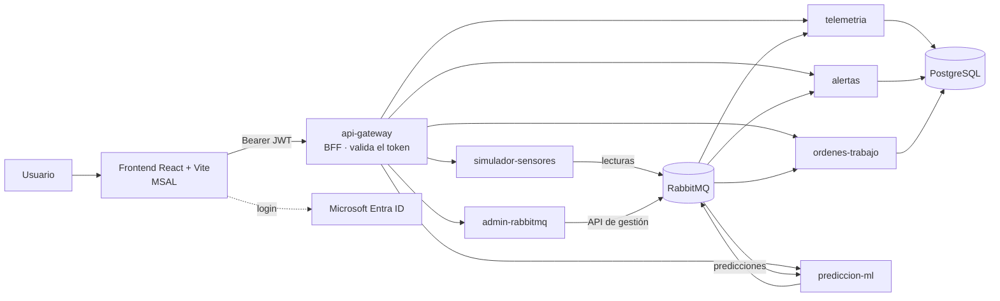

# EMaintenance · Mantenimiento predictivo

Plataforma de microservicios para monitorear equipos (camiones) en tiempo real, detectar anomalías con un modelo de machine learning y gestionar alertas y órdenes de trabajo. Los servicios se comunican de forma asíncrona con **RabbitMQ**, la autenticación y la autorización se hacen con **Microsoft Entra ID** (JWT) y todo corre en contenedores con **Docker Compose**.

## Qué hace

1. El simulador publica lecturas de **temperatura, vibración y presión** de cada equipo en RabbitMQ. Al inyectar una falla, los tres sensores se degradan de forma correlacionada: suben la temperatura y la vibración, y cae la presión.
2. `telemetria` valida y guarda las lecturas en PostgreSQL.
3. `prediccion-ml` puntúa las lecturas con un modelo de detección de anomalías (Isolation Forest).
4. `alertas` genera alertas a partir de **umbrales por tipo de sensor** (configurables en `application.yml`) y de las predicciones del modelo.
5. Cuando el administrador reconoce una alerta, se crea la **orden de trabajo**, que después se asigna a un técnico y avanza por su ciclo de vida en `ordenes-trabajo`.
6. `admin-rabbitmq` permite administrar colas, exchanges y bindings y reprocesar los mensajes de las DLQ.
7. El frontend (React + Vite) inicia sesión con Microsoft y muestra pantallas distintas según el rol del usuario.

## Arquitectura



Hacia afuera solo se publican el **gateway** (8080) y el **frontend** (5173). RabbitMQ, PostgreSQL y los demás servicios quedan dentro de la red de Docker.

## Servicios

| Servicio | Puerto | Tecnología | Rutas principales |
|---|---|---|---|
| `api-gateway` | 8080 | Spring Cloud Gateway (WebFlux) | Punto de entrada único |
| `admin-rabbitmq` | 8081 | Spring Boot | `/api/queues`, `/api/exchanges`, `/api/bindings`, `/api/dlq` |
| `telemetria` | 8082 | Spring Boot + PostgreSQL | `/api/lecturas` |
| `alertas` | 8083 | Spring Boot + PostgreSQL | `/api/alertas` |
| `ordenes-trabajo` | 8084 | Spring Boot + PostgreSQL | `/api/ordenes` |
| `simulador-sensores` | 8085 | Spring Boot | `/api/simulador` |
| `prediccion-ml` | 8086 | FastAPI (Python) | `/api/predicciones/estado`, `/health` |
| `mantenimiento-web` | 5173 | React + Vite + MSAL, servido con nginx | — |
| `ml` | — | Scripts de entrenamiento (scikit-learn) | No se despliega |

## Seguridad

La validación del token ocurre en **tres capas**, y ninguna depende de las otras:

1. **Gateway (BFF):** rechaza con `401` cualquier petición sin un JWT válido de Entra ID (firma, emisor, audiencia y expiración) antes de enrutarla.
2. **Cada microservicio:** vuelve a validar el JWT como *resource server* y aplica los permisos por rol. `prediccion-ml` hace lo mismo en Python, con caché de las llaves públicas de Microsoft.
3. **Frontend:** muestra u oculta pantallas y acciones según el claim `roles` del token.

### Roles

Los roles se definen como *app roles* en el registro de la API y se asignan en *Aplicaciones empresariales → Usuarios y grupos*.

| Rol | Puede |
|---|---|
| `Usuario` | Consultar y operar alertas, órdenes y el estado del simulador (`GET` y `PATCH`) |
| `Admin` | Todo lo anterior, además de eliminar, inyectar o revertir fallas del simulador y consultar telemetría |

Detalle por servicio:

| Servicio | Regla |
|---|---|
| `telemetria` | Todo solo para `Admin` |
| `simulador-sensores` | `POST` solo `Admin`; `GET /estado` para `Usuario` y `Admin` |
| `alertas`, `ordenes-trabajo`, `admin-rabbitmq`, `prediccion-ml` | `DELETE` solo `Admin`; el resto para `Usuario` y `Admin` |
| Todos | `/actuator/health` (o `/health`) es público; sin token da `401`; con token sin rol da `403` |

### Configuración en Entra ID

Se necesitan dos registros de aplicación en el mismo tenant:

- **API** (por ejemplo `mantenimiento-api`): expone el scope `access_as_user`, define los roles `Usuario` y `Admin`, y usa tokens v2 (`requestedAccessTokenVersion: 2`).
- **SPA** (por ejemplo `mantenimiento-web`): plataforma *Single-page application* con el redirect URI del frontend (`http://localhost:5173` en local), y el permiso delegado `access_as_user` de la API con consentimiento de administrador.

Los nombres del scope y de los roles son sensibles a mayúsculas y deben coincidir exactamente con los que usa el código (`access_as_user`, `Usuario`, `Admin`).

## Requisitos

- Docker y Docker Compose
- Node.js 20 o superior (solo si vas a correr el frontend en modo desarrollo)
- Un tenant de Microsoft Entra ID con los dos registros anteriores
- Opcional para desarrollo fuera de Docker: Java 21, Maven y Python 3.11

## Puesta en marcha

### 1. Variables de entorno

```bash
git clone https://github.com/gonzalopalma22/EMaintenance.git
cd EMaintenance
cp .env.example .env
```

Completa `.env`:

| Variable | Descripción |
|---|---|
| `POSTGRES_DB`, `POSTGRES_USER`, `POSTGRES_PASSWORD` | Base de datos compartida por `telemetria`, `alertas` y `ordenes-trabajo` |
| `RABBIT_USER`, `RABBIT_PASS` | Usuario inicial de RabbitMQ |
| `AZURE_TENANT_ID` | ID del directorio (tenant) |
| `AZURE_API_CLIENT_ID` | Client ID del registro de la **API** (es la audiencia que se valida) |
| `CORS_ORIGIN` | Origen permitido por el gateway (el frontend) |

> RabbitMQ y PostgreSQL solo leen el usuario y la contraseña la **primera vez** que crean su volumen. Si cambias esos valores después, hay que borrar el volumen correspondiente (`docker volume rm ...`).

### 2. Levantar todo

```bash
docker compose up -d --build
docker compose ps
```

- Un contenedor de un solo uso, `rabbit-init`, importa la topología de RabbitMQ (`rabbitmq/definitions.json`) al arrancar y termina con `Exited (0)`. Es lo esperado.
- El frontend queda disponible en `http://localhost:5173` y la API en `http://localhost:8080`.
- Para desarrollo local, crea un `docker-compose.override.yml` (está en el `.gitignore`) que abra los puertos de infraestructura solo hacia tu máquina:

```yaml
services:
  rabbitmq:
    ports:
      - "127.0.0.1:5672:5672"
      - "127.0.0.1:15672:15672"
  postgres:
    ports:
      - "127.0.0.1:5433:5432"
```

### 3. Frontend en modo desarrollo (opcional)

Si quieres recarga en caliente, detén el contenedor del frontend y corre Vite:

```bash
cd mantenimiento-web
npm install
npm run dev
```

Variables del frontend (`mantenimiento-web/.env`), que Vite lee al compilar:

```
VITE_TENANT_ID=<tenant id>
VITE_SPA_CLIENT_ID=<client id del registro SPA>
VITE_API_CLIENT_ID=<client id del registro de la API>
VITE_API_BASE_URL=http://localhost:8080
```

Abre `http://localhost:5173` e inicia sesión con una cuenta a la que le hayas asignado un rol.

## Probar el flujo de punta a punta

Todas las llamadas van al gateway (`http://localhost:8080`) con `Authorization: Bearer <token>`.

| Paso | Llamada | Esperado |
|---|---|---|
| Seguridad | `GET /api/alertas` sin token | `401` |
| Operación normal | `GET /api/lecturas?equipoId=camion-01` (Admin) | Lecturas de temperatura (~80 °C), vibración (~2 mm/s) y presión (~6 bar) |
| Inyectar una falla | `POST /api/simulador/falla/camion-01` (Admin) | `200`; suben temperatura y vibración, cae la presión |
| Detección | `GET /api/alertas` tras ~30 s | Alertas nuevas para `camion-01` |
| Gestión | `PATCH /api/alertas/{id}/reconocer` | Alerta reconocida |
| Órdenes | `PATCH /api/ordenes/{id}/estado` con `{"estado":"ASIGNADA","asignadoA":"..."}` | `200`; una transición inválida da `409` |
| Normalizar | `POST /api/simulador/normal/camion-01` (Admin) | Los sensores vuelven a la normalidad |
| Permisos | `POST /api/simulador/falla/camion-02` con rol `Usuario` | `403` |

Transiciones permitidas de una orden: `ABIERTA → ASIGNADA | CERRADA`, `ASIGNADA → EN_CURSO | CERRADA`, `EN_CURSO → CERRADA`. Una orden `CERRADA` no admite cambios.

## Modelo de machine learning

- **Algoritmo:** Isolation Forest (scikit-learn), con 200 árboles.
- **Entrenamiento:** solo con lecturas normales, para que lo anómalo destaque. El umbral de anomalía es el percentil 1 de los puntajes de datos normales y se guarda junto al modelo en un archivo de metadatos.
- **Modelo univariable (en uso):** usa el valor de la temperatura y su cambio (`delta`) respecto a la lectura anterior del mismo equipo. `prediccion-ml` lo carga desde `services/prediccion-ml/modelo/`, consume la cola de lecturas y publica un evento de predicción con el puntaje y la bandera `anomalia`.
- **Modelo multivariable v2 (entrenado, pendiente de integrar):** 6 variables por equipo (temperatura, vibración y presión, con sus deltas). Se conserva el modelo original mientras se integra en `prediccion-ml`.

Para reentrenar:

```bash
cd ml
python -m venv .venv && source .venv/bin/activate
pip install -r requirements.txt
python entrenar.py        # modelo univariable; también hay un script para el multivariable
```

Copia los archivos generados a `services/prediccion-ml/modelo/` y reconstruye la imagen (`docker compose up -d --build prediccion-ml`). El modelo debe cargarse con la **misma versión de scikit-learn** con la que se entrenó.

## RabbitMQ

- La topología (colas, exchanges y bindings, con sus DLQ y colas de auditoría) vive en `rabbitmq/definitions.json` y se importa automáticamente con `rabbit-init`.
- En el despliegue no se publica la consola de gestión. La administración se hace a través del servicio `admin-rabbitmq` y su API.
- Los mensajes rechazados van a las DLQ; `GET /api/dlq/{cola}/mensajes` los muestra y `POST /api/dlq/{cola}/reprocesar` los reenvía.

## Estructura del repositorio

```
.
├── docker-compose.yml
├── .env.example
├── rabbitmq/
│   └── definitions.json        # topología importada por rabbit-init
├── services/
│   ├── api-gateway/
│   ├── admin-rabbitmq/
│   ├── telemetria/
│   ├── alertas/
│   ├── ordenes-trabajo/
│   ├── simulador-sensores/
│   └── prediccion-ml/
│       └── modelo/             # modelo entrenado y metadatos
├── ml/                         # scripts de entrenamiento
└── mantenimiento-web/          # React + Vite + MSAL
```

## Decisiones de diseño

- **RabbitMQ y no Kafka:** el flujo se apoya en colas con acuse de recibo, reintentos y dead-letter, y el servicio `admin-rabbitmq` administra esa topología. Con tres equipos y una lectura cada 3 segundos, un log distribuido no aporta lo suficiente para justificar su costo operativo.
- **Cada servicio valida su propio JWT:** el gateway rechaza tokens inválidos, pero ningún servicio confía ciegamente en él. Si uno quedara expuesto por error, seguiría protegido.
- **Un solo registro de API en Entra ID:** los servicios comparten audiencia y roles, y los permisos se definen por rol, no por servicio.
- **CORS solo en el gateway:** los servicios no responden a navegadores directamente, y se evitan cabeceras duplicadas.
- **Orden de trabajo al reconocer la alerta:** una alerta no abre una orden por sí sola; la crea el administrador al reconocerla, y luego se asigna a un técnico.

## Limitaciones conocidas

- `prediccion-ml` todavía usa el modelo univariable; el multivariable está entrenado pero falta integrarlo.
- No hay deduplicación por falla sostenida: cada lectura que supera un umbral genera su alerta (la unicidad es por lectura y tipo).
- `GET /api/lecturas` devuelve las últimas 100 lecturas sin filtrar por tipo de sensor.
- En `admin-rabbitmq`, un `Usuario` puede crear colas, exchanges y bindings y reprocesar DLQ; solo `DELETE` está restringido a `Admin`.
- El despliegue en AWS no está hecho; ver la guía de abajo.

## Hoja de ruta

1. Integrar el modelo multivariable en `prediccion-ml` y mostrar los tres sensores en el frontend.
2. Asignación de órdenes con un desplegable de técnicos (usuarios con rol `Usuario`) leído desde Entra ID con Microsoft Graph.
3. Deduplicar alertas abiertas por equipo.
4. Estimación de vida útil restante (RUL) con regresión sobre ventanas hasta la falla.
5. Despliegue en AWS.


## Autor

Gonzalo Palma · [github.com/gonzalopalma22](https://github.com/gonzalopalma22)